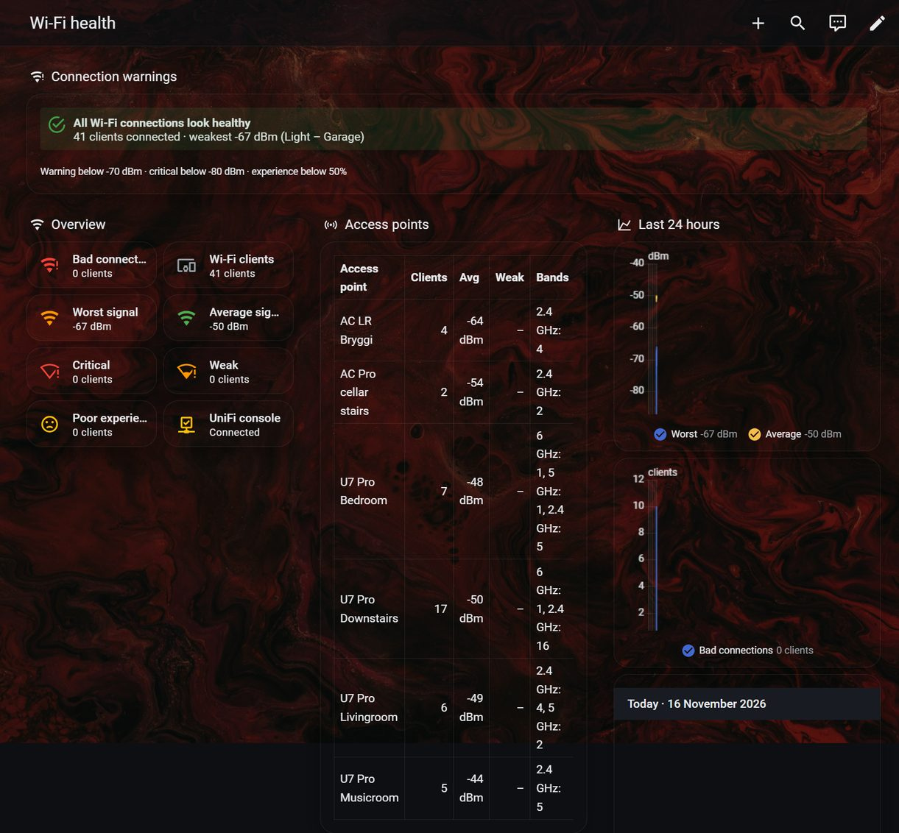

# Sanfeld's Home Assistant apps

[](https://my.home-assistant.io/redirect/supervisor_add_addon_repository/?repository_url=https%3A%2F%2Fgithub.com%2FSanfeld%2Fhome-assistant-apps)

## Installation

Click the button above, or in Home Assistant go to **Settings → Apps → App store → ⋮ →
Repositories** and add:

```
https://github.com/Sanfeld/home-assistant-apps
```

## Apps

### [Wi-Fi Signal Monitor](./wifi_monitor)

![Supports aarch64 Architecture][aarch64-shield]
![Supports amd64 Architecture][amd64-shield]

Watches the signal strength of every Wi-Fi client on your UniFi network and warns about bad
connections. It comes with a ready-made [dashboard](./dashboards/wifi_monitor.yaml) and a
[phone alerts blueprint](./blueprints/automation/wifi_monitor_phone_alerts.yaml).

[](https://my.home-assistant.io/redirect/blueprint_import/?blueprint_url=https%3A%2F%2Fgithub.com%2FSanfeld%2Fhome-assistant-apps%2Fblob%2Fmain%2Fblueprints%2Fautomation%2Fwifi_monitor_phone_alerts.yaml)



## About

Built and tested on a home UniFi network (UCG Max with U7 Pro and AC Pro access points).
Developed with help from Claude (Anthropic's AI assistant); all code was reviewed and is
run daily by the maintainer. Issues and pull requests are welcome.

[aarch64-shield]: https://img.shields.io/badge/aarch64-yes-green.svg
[amd64-shield]: https://img.shields.io/badge/amd64-yes-green.svg
